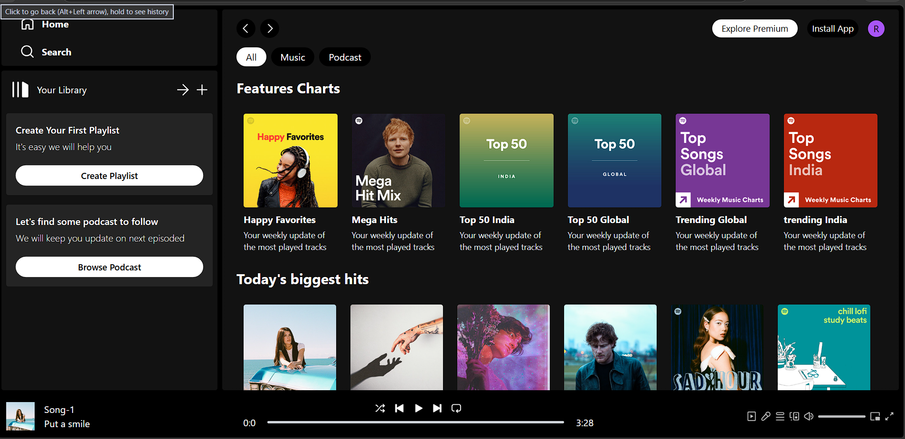
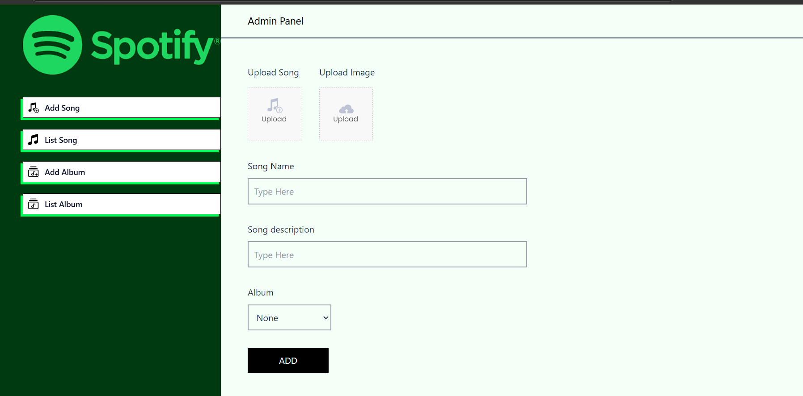
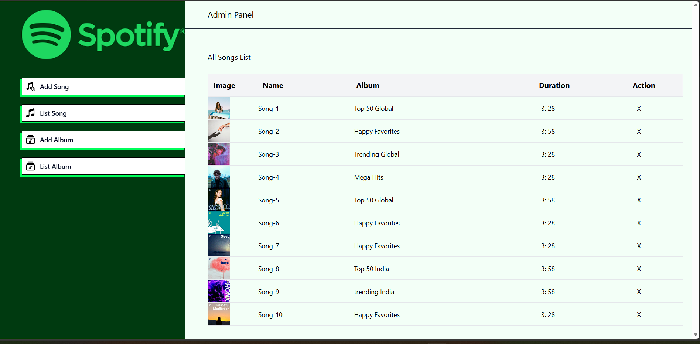
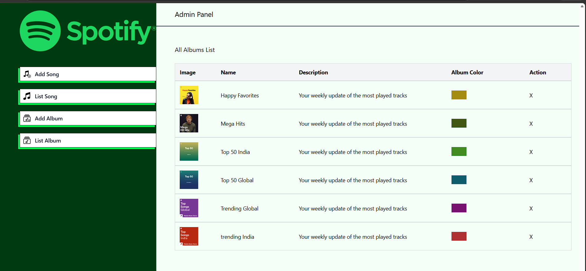

🎵 Spotify Full-Stack Music App

A Spotify-inspired full-stack music streaming application built using the MERN stack. The project includes a user-facing music player, a dedicated admin dashboard, and a backend API for managing songs and albums.

#Features

#🎧 User Application
- Browse available songs and albums.
- Play and pause music.
- Switch between previous and next tracks.
- Interactive music playback and progress controls.
- Dynamic song and album data fetched from the backend.

#Admin Dashboard
- Upload new songs.
- Add song details, including name and description.
- Upload song artwork and audio files.
- Add and manage albums.
- Remove songs and albums.

# Backend
- REST API built with Node.js and Express.js.
- MongoDB integration using Mongoose.
- File upload handling with Multer.
- Cloudinary integration for media storage.

# Tech Stack

 Technology --> Purpose 

 React.js --> Frontend development 
 Vite --> Development and build tooling 
 Tailwind CSS --> UI styling 
 JavaScript --> Application logic 
 Node.js --> Backend runtime 
 Express.js --> REST API 
 MongoDB --> Database 
 Mongoose --> Database modelling 
 Cloudinary --> Audio and image storage 
 Multer --> File uploads 
 Axios --> API requests 

# Project Structure

```text
Spotify-fullstack/
│
├── spotify-clone/       # User-facing React application
│   ├── src/
│   │   ├── components/
│   │   ├── context/
│   │   └── ...
│   └── package.json
│
├── spotify-admin/       # Admin dashboard
│   ├── src/
│   └── package.json
│
├── Spotify-backend/     # Node.js and Express backend
│   ├── src/
│   │   ├── config/
│   │   ├── controllers/
│   │   ├── middleware/
│   │   ├── models/
│   │   └── routes/
│   └── package.json
│
├── .gitignore
└── README.md
```

# Getting Started

# Prerequisites

Make sure you have installed:

- [Node.js](https://nodejs.org/)
- npm
- MongoDB database
- Cloudinary account

1. Clone the repository

```bash
git clone https://github.com/riachaudhary-dev/Spotify-Full-Stack-Music-App.git
cd Spotify-Full-Stack-Music-App
```

 2. Install backend dependencies

```bash
cd Spotify-backend
npm install
```

3. Configure environment variables

Create a `.env` file inside the `Spotify-backend` directory.

Add the environment variables required by your backend configuration, including your MongoDB and Cloudinary credentials.


 4. Start the backend

From the `Spotify-backend` directory:

```bash
npm run server
```

The backend runs on port `4000`.

 5. Start the user application

Open a new terminal from the project root:

```bash
cd spotify-clone
npm install
npm run dev
```

 6. Start the admin dashboard

Open another terminal from the project root:

```bash
cd spotify-admin
npm install
npm run dev
```

Keep all three applications running while testing locally.


📸 Screenshots

# Spotify User Application



# Admin Dashboard

Add Song



List Songs



List Albums



# Project Purpose

This project was developed to gain practical experience in full-stack web development, including:

- Building reusable React components.
- Managing global state using React Context API.
- Developing REST APIs.
- Integrating MongoDB with a Node.js backend.
- Handling audio and image uploads.
- Integrating Cloudinary for media storage.
- Connecting frontend applications with backend services.

#Author

Riya Chaudhary

GitHub: [@riachaudhary-dev](https://github.com/riachaudhary-dev)

---

*This project is built for educational and portfolio purposes. It is inspired by Spotify and is not affiliated with or endorsed by Spotify.*
